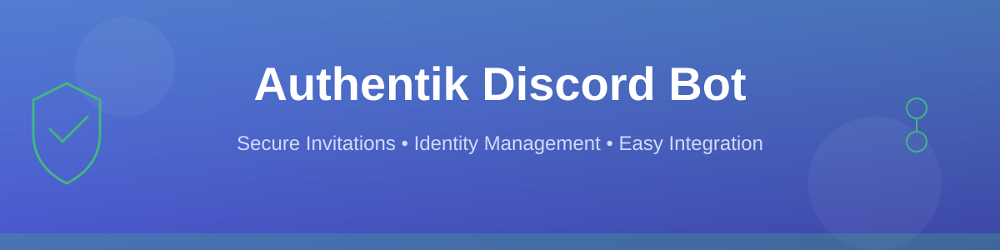

# Authentik Discord Invite Bot


A Discord bot written in Go that generates secure, time-limited invitation links from Authentik identity provider. When users run `/invite` in Discord, the bot creates a new Authentik invite with a customizable expiration time and posts the link in a code block.

## Features

- **Discord Slash Command**: Simple `/invite` command for generating invites
- **Customizable Expiration**: Set default expiration hours or override per-request
- **Random Slugs**: Each invitation gets a unique, randomly generated identifier
- **Single-Use Invites**: All generated invites are one-time use only
- **Auto-Delete Messages**: Discord messages are automatically deleted 5 minutes after creation for privacy
- **Persistent Invites**: Invite links remain active in Authentik until they expire or are used
- **Docker Ready**: Includes Dockerfile and docker-compose configuration
- **Error Handling**: Comprehensive error messages for troubleshooting
- **Code Block Output**: Invite links are formatted in Discord code blocks for easy copying

## Prerequisites

### 📋 Discord Bot Setup

> **Location:** [Discord Developer Portal](https://discord.com/developers/applications)

#### Step 1: Create Application
1. Click **New Application** button
2. Enter a name: `Authentik Invite Bot` (or your preferred name)
3. Click **Create**

#### Step 2: Configure Bot as Private

> ⚠️ **Important:** Keep `bot_public` disabled to ensure only you (the owner) can add this bot to servers.

1. Navigate to **Bot** tab (left sidebar)
2. Scroll down to **Authorization Flow** section
3. Ensure **PUBLIC BOT** is **UNCHECKED** ✓
   - This restricts bot invitations to the owner account only
   - No one else can use an invite link, even if they have it
4. Ensure **REQUIRES OAUTH2 CODE GRANT** is **UNCHECKED** ✓
   - This allows simple bot authorization without complex OAuth2 flow
   - Only enable this if you need to request additional user scopes

#### Step 2b: Disable Install Link (Private Mode)

> For a truly private bot, disable the automatic install link in Discord.

1. Navigate to **Installation** tab (left sidebar)
2. Go to **Install Link** section
3. Select **None** ✓
   - This disables the "Add App" button on your bot's profile
   - Users won't see an automatic invite link
   - You must manually share the OAuth2 URL from Step 3

> 💡 **Note:** With `bot_public` disabled and install link disabled, you have complete control. Only you (the owner) can add the bot to servers by using the OAuth2 URL you generate.

#### Step 3: Get OAuth2 Credentials

1. Navigate to **OAuth2 → URL Generator** tab (left sidebar)
2. Under **SCOPES**, select:
   - ✅ `bot`
   - ✅ `applications.commands`
3. Under **BOT PERMISSIONS** (appears after selecting `bot` scope), select:
   - ✅ `Send Messages`
   - ✅ `Manage Messages` (required to delete messages after 5 minutes)
4. Scroll down to **GENERATED URL** section
5. Copy the URL → Save this for Step 6 ✓

> 🔒 **Security:** This URL will only work when you (the owner) are logged in. Others attempting to use it will see "Only the owner can add this bot."

#### Step 4: Configure Bot Token

1. Still on the **Bot** tab (left sidebar)
2. Click **Reset Token** (or **Copy** if it's a new bot)
3. Under **TOKEN** section:
   - Copy your bot token
   - ⚠️ **IMPORTANT:** Keep this token secure! Never share it or commit to version control.
   - **This becomes your `DISCORD_TOKEN`** ✓

#### Step 5: Enable Privileged Intents (if needed)
1. Still on the **Bot** tab, scroll to **Privileged Gateway Intents** section
2. Enable (only if your bot needs to read message content):
   - ✅ Message Content Intent

> 💡 **Note:** This bot doesn't require Message Content Intent by default.

#### Step 6: Invite Bot to Your Server
1. Take the **Generated URL** you copied from Step 3
2. Open the URL in your browser (while logged in as the bot owner)
3. Select your Discord server from the dropdown
4. Click **Authorize**
5. Complete the CAPTCHA if prompted
5. Select your Discord server from the dropdown
6. Click **Authorize**
7. Complete the CAPTCHA if prompted

**Result:** Your bot is now in your Discord server! → `DISCORD_TOKEN` ✓

### 🔐 Authentik Setup

#### Finding Your Authentik URL
1. Open your Authentik instance in a browser (e.g., `https://authentik.example.com`)
2. The base URL is your `AUTHENTIK_URL` ✓

**Example:** `https://authentik.example.com` → `AUTHENTIK_URL` ✓

#### Finding Your Authentik Flow Slug
1. Log in to **Authentik Admin Panel**
2. Navigate to **Flows & Stages → Flows** (left sidebar)
3. Look for an enrollment or invitation flow:
   - 🎯 Common names:
     - `default-enrollment-flow`
     - `enrollment`
     - `invite`
     - Or your custom enrollment flow
4. Click on the flow to open it
5. Look at the **Slug** field (in the flow details)
6. Note the slug value → `AUTHENTIK_FLOW_SLUG` ✓

**Example:** If slug is `enrollment`, then `AUTHENTIK_FLOW_SLUG=enrollment` ✓

#### Creating Your Authentik API Token
1. Log in to **Authentik Admin Panel**
2. Navigate to **Administration → System → Tokens & App Passwords** (left sidebar)
3. Click **Create** button (top right)
4. Fill in the form:
   - **Identifier/Name:** `Discord Bot` (or any descriptive name)
   - **Intent:** Select **API Token**
     - API Tokens are for programmatic API access (Bearer token)
     - Do not use "App password" here — those are for flow executor logins
   - **User:** Choose an account that has permission to manage invitations/groups
   - **Expiration:** Set a date (recommended) or leave empty
   - **Permissions:** Ensure the chosen user has invitation management rights
5. Click **Create**
6. ⚠️ **IMMEDIATELY copy the token value** (you won't see it again!)
7. This is your `AUTHENTIK_TOKEN` ✓

**Result:** You have all three Authentik credentials:
- `AUTHENTIK_URL` ✓
- `AUTHENTIK_FLOW_SLUG` ✓
- `AUTHENTIK_TOKEN` ✓

## Installation

### Using Docker Compose (Recommended)

1. Clone or navigate to the bot directory:
   ```bash
   cd AuthentikBot
   ```

2. Create a `.env` file with your configuration:
   ```env
   DISCORD_TOKEN=your_discord_bot_token_here
   AUTHENTIK_URL=https://authentik.example.com
   AUTHENTIK_TOKEN=your_authentik_api_token_here
   AUTHENTIK_FLOW_SLUG=default-enrollment-flow
   INVITE_EXPIRATION_HOURS=24
   ```
   
   **Reference your values from the Prerequisites section above:**
   - `DISCORD_TOKEN` - From Discord Developer Portal Bot tab
   - `AUTHENTIK_URL` - Your Authentik instance URL
   - `AUTHENTIK_TOKEN` - From Authentik Tokens & App Passwords
   - `AUTHENTIK_FLOW_SLUG` - From Authentik Flows page
   - `INVITE_EXPIRATION_HOURS` - Optional, defaults to 24

3. Start the bot:
   ```bash
   docker-compose up -d
   ```

4. View logs to confirm it's running:
   ```bash
   docker-compose logs -f authentik-bot
   ```
   
   You should see:
   ```
   Bot is running. Press CTRL-C to exit.
   ```

5. Test the bot in Discord:
   - Go to any channel where the bot is present
   - Type `/invite` and press Enter
   - The bot should respond with an invite link

### Manual Go Installation

1. Install Go 1.21 or later

2. Navigate to the bot directory and install dependencies:
   ```bash
   cd AuthentikBot
   go mod download
   ```

3. Create a `.env` file or set environment variables:
   
   **On Linux/Mac:**
   ```bash
   export DISCORD_TOKEN=your_discord_bot_token_here
   export AUTHENTIK_URL=https://authentik.example.com
   export AUTHENTIK_TOKEN=your_authentik_api_token_here
   export AUTHENTIK_FLOW_SLUG=default-enrollment-flow
   export INVITE_EXPIRATION_HOURS=24
   ```
   
   **On Windows (PowerShell):**
   ```powershell
   $env:DISCORD_TOKEN="your_discord_bot_token_here"
   $env:AUTHENTIK_URL="https://authentik.example.com"
   $env:AUTHENTIK_TOKEN="your_authentik_api_token_here"
   $env:AUTHENTIK_FLOW_SLUG="default-enrollment-flow"
   $env:INVITE_EXPIRATION_HOURS="24"
   ```

4. Run the bot:
   ```bash
   go run main.go
   ```
   
   You should see:
   ```
   Logged in as: YourBotName#0000
   Successfully registered 1 commands
   Bot is running. Press CTRL-C to exit.
   ```

5. Test the bot in Discord:
   - Type `/invite` in any Discord channel
   - The bot should respond with an invite link

## Configuration

All configuration is done through environment variables:

| Variable | Required | Description | Example |
|----------|----------|-------------|---------|
| `DISCORD_TOKEN` | Yes | Discord bot token | `MzA1Mzk0ODI4NzQyNzk1ODQw...` |
| `AUTHENTIK_URL` | Yes | Base URL of Authentik instance | `https://authentik.example.com` |
| `AUTHENTIK_TOKEN` | Yes | Authentik API token with invitation permissions | `gho_16C7e42F292c6912E7710c838...` |
| `AUTHENTIK_FLOW_SLUG` | Yes | Slug of the enrollment/invitation flow | `default-enrollment-flow` |
| `INVITE_EXPIRATION_HOURS` | No | Default expiration time in hours (default: 24) | `48` |

### Getting Authentik API Token

1. Log in to your Authentik admin panel
2. Navigate to: **Administration → System → Tokens & App Passwords**
3. Click **Create** to create a new token
4. Set an expiration date (or leave empty for no expiration)
5. Select appropriate permissions (requires invitation management)
6. Copy the generated token value

### Discord Permissions

Ensure your bot has the following permissions in your Discord server:
- Send Messages
- Use Application Commands (Slash Commands)

## Usage

### Basic Invite Command

In any Discord channel where the bot is present:

```
/invite
```

This will generate a one-time use invite link that expires in the default time (default 24 hours).

**Bot Response:**
```
✅ Invite generated (expires in 24 hours):
```
https://authentik.example.com/if/enrollment/default-enrollment-flow/?code=abc123def456
```
```

**Important:** The invite link message will be automatically deleted from Discord after 5 minutes, but the invite link itself remains active in Authentik until:
- The expiration time is reached, OR
- Someone uses the invite (one-time use only)

### Custom Expiration

Specify a custom expiration time in hours:

```
/invite expiration:48
```

This generates a one-time use invite that expires in 48 hours.

**Bot Response:**
```
✅ Invite generated (expires in 48 hours):
```
https://authentik.example.com/if/enrollment/default-enrollment-flow/?code=xyz789abc123
```
```

The message will be automatically deleted after 5 minutes from Discord, but users can still use the invite link within Authentik until it expires or is consumed.

### Expiration Limits

- Minimum: 1 hour
- Maximum: 8760 hours (1 year)
- Default: Configurable via `INVITE_EXPIRATION_HOURS`

## How It Works

### Group Management Command

Manage group membership and list groups in Authentik directly from Discord:

```
/group action:add group:developers username:john.doe
```

**Parameters:**
- `action`: Either `add`, `remove`, or `list`
- `group`: The name of the Authentik group (required for `add`/`remove`, omitted for `list`)
- `username`: The username to add or remove from the group (required for `add`/`remove`)

**Examples:**

Add a user to a group:
```
/group action:add group:developers username:alice.smith
```

**Bot Response:**
```
✅ User 'alice.smith' added to group 'developers'
```

Remove a user from a group:
```
/group action:remove group:developers username:bob.jones
```

**Bot Response:**
```
✅ User 'bob.jones' removed from group 'developers'
```

List all groups (paginated):
```
/group action:list
```

**Bot Response:**
```
Groups (12 total):
developers — Development team
admins — System administrators
support — Support team
marketing — Marketing department
... (multiple pages if many groups)
```

The list is automatically paginated and sent in code blocks if the output is long.

**Immutable Users:** Users listed in the `IMMUTABLE_USERNAMES` configuration cannot be added or removed from groups. Attempting to modify them will result in an error:
```
❌ User 'admin' is immutable and cannot be modified
```

### User Listing Command

List all Authentik users excluding immutable ones, with full names:

```
/user action:list
```

Example output (formatted in code blocks, chunked if long):
```
Users (5, excluding immutable):
alice.smith — Alice Smith
bob.jones — Bob Jones
charlie — Charlie Doe
dan — Daniel Example
eve — Eve Adams
```

## How It Works

1. User executes `/invite [expiration]` command in Discord
2. Bot acknowledges the request with a deferred response
3. Bot generates a random 16-character slug
4. Bot calls Authentik API to create a **one-time use** invitation with:
   - Random slug name
   - Specified expiration time (in seconds)
   - `single_use: true` to ensure the invite can only be used once
   - Flow associations
5. Authentik returns the invitation link
6. Bot posts the link to Discord in a code block for easy copying
7. **Automatically:** After 5 minutes, the bot deletes the Discord message
8. The invite link remains active in Authentik until expiration or consumption

This approach provides privacy by clearing Discord message history while maintaining the invite in Authentik.

## API Integration

The bot communicates with Authentik's API at the following endpoint:

```
POST /api/v3/flows/invitations/
```

**Request Body:**
```json
{
  "name": "a1b2c3d4e5f6g7h8",
  "expires_in": 86400,
  "single_use": true
}
```

**Response:**
```json
{
  "pk": 123,
  "slug": "a1b2c3d4e5f6g7h8",
  "link": "https://authentik.example.com/if/enrollment/default-enrollment-flow/?code=xyz789",
  "error": null
}
```

## Docker Deployment

### Building the Image

```bash
docker build -t authentik-bot:latest .
```

### Running as Container

```bash
docker run -d \
  --name authentik-bot \
  -e DISCORD_TOKEN=your_token \
  -e AUTHENTIK_URL=https://authentik.example.com \
  -e AUTHENTIK_TOKEN=your_api_token \
  -e AUTHENTIK_FLOW_SLUG=default-enrollment-flow \
  authentik-bot:latest
```

### Docker Compose

Use the provided `docker-compose.yml`:

```bash
# Start
docker-compose up -d

# Stop
docker-compose down

# View logs
docker-compose logs -f authentik-bot

# Rebuild
docker-compose up -d --build
```

## Troubleshooting

### Bot doesn't respond to commands

1. Check that the bot is online:
   ```bash
   docker-compose logs authentik-bot
   ```

2. Verify the bot has "Use Application Commands" permission in the channel

3. Ensure `DISCORD_TOKEN` is correct and the bot still has valid permissions

### "Failed to generate invite" error

1. Verify `AUTHENTIK_URL` is reachable from the container
2. Check that `AUTHENTIK_TOKEN` has valid permissions:
   - Test with curl:
     ```bash
     curl -H "Authorization: Bearer YOUR_TOKEN" \
       https://authentik.example.com/api/v3/core/system_tasks/
     ```

3. Confirm `AUTHENTIK_FLOW_SLUG` exists and is correct

4. Check container logs:
   ```bash
   docker-compose logs authentik-bot
   ```

### Networking Issues

If the bot cannot reach Authentik:

1. Ensure both services are on the same network (if using docker-compose)
2. Check firewall rules between Docker host and Authentik
3. Verify DNS resolution for `AUTHENTIK_URL`
4. Test connectivity from container:
   ```bash
   docker-compose exec authentik-bot wget https://authentik.example.com
   ```

## Security Considerations

- **API Token**: Store `AUTHENTIK_TOKEN` securely, use Docker secrets in production
- **Bot Token**: Never commit bot tokens to version control
- **HTTPS**: Always use HTTPS for Authentik URLs in production
- **Permissions**: Create Authentik API token with minimal required permissions
- **Rate Limiting**: Consider implementing rate limiting in production
- **Audit**: Monitor invitation creation in Authentik audit logs

## Development

### Project Structure

```
AuthentikBot/
├── main.go              # Main bot logic and Discord integration
├── go.mod               # Go module definition
├── go.sum               # Dependency checksums
├── Dockerfile           # Multi-stage Docker build
├── docker-compose.yml   # Docker Compose configuration
├── .env.example         # Example environment configuration
└── README.md            # This file
```

### Building from Source

```bash
go mod download
CGO_ENABLED=0 go build -o authentik-bot main.go
./authentik-bot
```

### Dependencies

- `github.com/bwmarrin/discordgo`: Discord API bindings
- `github.com/google/uuid`: UUID generation for random slugs

## License

[Insert your license here]

## Support

For issues or questions:
1. Check the troubleshooting section above
2. Review Authentik API documentation: https://docs.goauthentik.io/
3. Review Discord.go documentation: https://github.com/bwmarrin/discordgo

## Future Enhancements

Potential improvements:
- [ ] Rate limiting per user
- [ ] Invite history/tracking
- [ ] Batch invite generation
- [ ] Custom attributes for invites
- [ ] Web dashboard for invite management
- [ ] Multiple flow support
- [ ] Prometheus metrics
- [ ] Invite tracking/analytics
